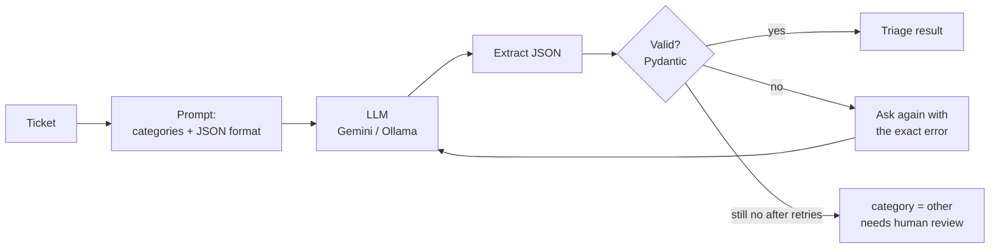

# AI Ticket Triage


An internal tool that uses an LLM to automate how a company handles incoming support tickets:
classify each ticket, extract its key details, score its urgency, summarise it and route it to the right team.

> 🚧 Work in progress, built in stages. See the roadmap below.

## Roadmap

- [x] **Stage 1:** project setup, ticket data model, FastAPI service, labelled sample dataset, tests
- [x] **Stage 2:** LLM client and ticket classification with validated JSON output
- [ ] **Stage 3:** orchestration: classify → extract → urgency → route, with business rules
- [ ] **Stage 4:** storage in SQL and batch automation
- [ ] **Stage 5:** evaluation: accuracy, latency and cost across models
- [ ] **Stage 6:** Docker, dashboard and final documentation

## How classification works



LLMs don't always follow instructions: they wrap JSON in code fences, add sentences, or invent categories.
So the answer is never trusted blindly:

1. The JSON object is extracted from the answer, even if surrounded by text.
2. It is validated against a Pydantic model (category must be one of 5 values, confidence between 0 and 1).
3. If invalid, the LLM is asked again, and told exactly which field was wrong.
4. If it still fails, the ticket falls back to `other` and is flagged for a human. The API never crashes.
5. Low-confidence answers (< 0.5) are also flagged for human review.

The LLM is behind a small interface (`complete(system, user) -> str`), so the provider can be swapped by changing one setting:

| `LLM_PROVIDER` | What it uses |
|---|---|
| `gemini` | Google Gemini through its OpenAI-compatible API (free key from [Google AI Studio](https://aistudio.google.com)) |
| `ollama` | A model running locally with [Ollama](https://ollama.com), no key, no data leaves the machine |
| `fake` | A keyword-based stand-in: works offline, used for development and tests |

## Run it

```bash
python -m venv .venv
source .venv/bin/activate        # Windows: .venv\Scripts\activate
pip install -r requirements.txt

cp .env.example .env             # then put your Gemini key in .env (or set LLM_PROVIDER=fake)
uvicorn app.main:app --reload    # open http://localhost:8000/docs
pytest -q
```

Try it: `POST /tickets` to create a ticket, then `POST /tickets/{id}/classify`.

## API

| Method | Endpoint | What it does |
|---|---|---|
| GET | `/health` | Service status |
| POST | `/tickets` | Receive a new ticket (validated) |
| GET | `/tickets` | List tickets, newest first |
| GET | `/tickets/{id}` | Get one ticket |
| POST | `/tickets/{id}/classify` | Classify the ticket with the LLM and store the result |

## Project structure

```
app/
  main.py               FastAPI endpoints
  models.py             Ticket, Classification and TriageResult models (Pydantic)
  store.py              in-memory ticket storage (SQL in stage 4)
  config.py             settings from .env
  llm/
    base.py             the LLM interface
    openai_compat.py    HTTP client for Gemini / Ollama, with retries on rate limits
    fake.py             offline fake LLM
    factory.py          picks the client from LLM_PROVIDER
  triage/
    classifier.py       prompt, JSON extraction, validation, retries, fallback
data/sample_tickets.jsonl   50 labelled tickets (EN/FR) for evaluation
tests/                      20 tests, no network or API key needed
```
