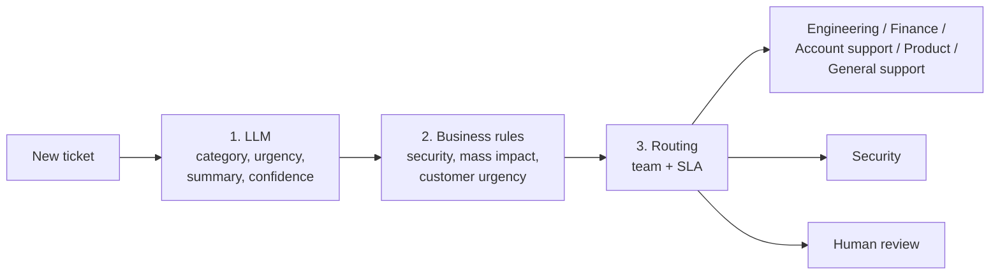
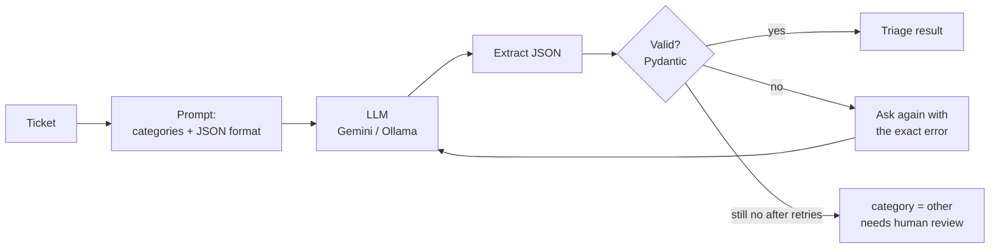

# AI Ticket Triage


An internal tool that uses an LLM to automate how a company handles incoming support tickets:
classify each ticket, extract its key details, score its urgency, summarise it and route it to the right team.

> 🚧 Work in progress, built in stages. See the roadmap below.

## Roadmap

- [x] **Stage 1:** project setup, ticket data model, FastAPI service, labelled sample dataset, tests
- [x] **Stage 2:** LLM client and ticket classification with validated JSON output
- [x] **Stage 3:** urgency and summary from the LLM, business rules, routing to teams with SLAs
- [x] **Stage 4:** SQLite storage and an idempotent, resumable batch job
- [ ] **Stage 5:** evaluation: accuracy, latency and cost across models
- [ ] **Stage 6:** Docker, dashboard and final documentation

## How triage works



The LLM is used for what it does well: understanding free text in English or French.
Decisions that must be predictable and auditable are made in plain code:

| Rule | Effect |
|---|---|
| Security incident (hacked, suspicious login, phishing, *piraté*…) | always **high**, sent to the **security** team, human review |
| Many people blocked (*"none of our 300 employees"*, *"all users"*…) | raised to **high** (not for feature requests) |
| Customer says "urgent" | never left at **low**, raised to **medium** only |
| Feature request | never **high**: capped at **medium** |

Every rule that fires is listed in `rules_applied`, so each decision can be explained.
Tickets the AI is unsure about (confidence < 0.5 or invalid output) go to **human review**.
The rules are tested against the 50 labelled tickets so they never overturn a correct label.

| Final urgency | SLA (first answer within) |
|---|---|
| high | 4 hours |
| medium | 24 hours |
| low | 72 hours |

## How classification works



LLMs don't always follow instructions: they wrap JSON in code fences, add sentences, or invent categories.
So the answer is never trusted blindly:

1. The JSON object is extracted from the answer, even if surrounded by text.
2. It is validated against a Pydantic model (category must be one of 5 values, confidence between 0 and 1).
3. If invalid, the LLM is asked again, and told exactly which field was wrong.
4. If it still fails, the ticket falls back to `other` and is flagged for a human. The API never crashes.
5. Low-confidence answers (< 0.5) are also flagged for human review.

The LLM is behind a small interface (`complete(system, user) -> str`), so the provider can be swapped by changing one setting:

| `LLM_PROVIDER` | What it uses |
|---|---|
| `gemini` | Google Gemini through its OpenAI-compatible API (free key from [Google AI Studio](https://aistudio.google.com)) |
| `ollama` | A model running locally with [Ollama](https://ollama.com), no key, no data leaves the machine |
| `fake` | A keyword-based stand-in: works offline, used for development and tests |

## Run it

```bash
python -m venv .venv
source .venv/bin/activate        # Windows: .venv\Scripts\activate
pip install -r requirements.txt

cp .env.example .env             # then put your Gemini key in .env (or set LLM_PROVIDER=fake)
uvicorn app.main:app --reload    # open http://localhost:8000/docs
pytest -q
```

Try it: `POST /tickets` to create a ticket, then `POST /tickets/{id}/triage`.
Tickets are saved in `tickets.db` (SQLite), so they are still there after a restart.

## Batch processing

Triage a whole file of tickets in one command (results are stored in `tickets.db`):

```bash
python -m app.batch data/sample_tickets.jsonl            # all 50 tickets
python -m app.batch data/sample_tickets.jsonl --limit 5  # just the first 5
```

```
[1/50] T001 bug             -> engineering     medium SLA 24h  (0.8s)
[2/50] T002 billing         -> finance         medium SLA 24h  (0.7s)
[3/50] T003 account_access  -> account_support high   SLA  4h  (0.9s)
...
=== Batch summary ===
Triaged now: 50   Already done (skipped): 0
All tickets in the database:
  by team           {'finance': 11, 'engineering': 10, ...}
```

The job is built like a production data pipeline:

- **Idempotent:** each ticket keeps its id from the file and finished tickets are skipped,
  so running the job twice never triages (or pays for) a ticket twice.
- **Resumable:** if the LLM stops answering (rate limit, quota, network), the job stops cleanly;
  run the same command again and it continues where it stopped.
- **Rate-limit friendly:** waits 4 seconds between LLM calls by default (`--delay`).

## Evaluation

After the batch job, compare the results with the correct labels:

```bash
python -m app.evaluate data/sample_tickets.jsonl
```

It prints a summary and writes a full report to [`reports/evaluation.md`](reports/evaluation.md):
category accuracy, urgency accuracy before and after the business rules, serious errors
(high ↔ low), confusion matrices, and whether the LLM's confidence can be trusted.

## Analysing the results with SQL

Each ticket is one row in the `tickets` table, with the LLM's answer (`llm_urgency`) and the
final decision after the rules (`final_urgency`) in separate columns. Open `tickets.db` with
any SQLite tool (e.g. *DB Browser for SQLite*, or the *SQLite Viewer* extension in VS Code):

```sql
-- How many tickets each team received, by urgency
SELECT team, final_urgency, COUNT(*) AS tickets
FROM tickets GROUP BY team, final_urgency ORDER BY team;

-- Where the business rules overruled the LLM
SELECT id, subject, llm_urgency, final_urgency, rules_applied
FROM tickets WHERE llm_urgency <> final_urgency;

-- Tickets waiting for a human
SELECT id, subject, category, confidence FROM tickets WHERE needs_human_review = 1;
```

## API

| Method | Endpoint | What it does |
|---|---|---|
| GET | `/health` | Service status |
| POST | `/tickets` | Receive a new ticket (validated) |
| GET | `/tickets` | List tickets, newest first |
| GET | `/tickets/{id}` | Get one ticket |
| POST | `/tickets/{id}/classify` | LLM classification only |
| POST | `/tickets/{id}/triage` | Full workflow: LLM → business rules → team and SLA |
| GET | `/stats` | Ticket counts, total and per category |

## Project structure

```
app/
  main.py               FastAPI endpoints
  models.py             Ticket, Classification, TriageResult and Routing models (Pydantic)
  store.py              SQLite storage (one row per ticket, LLM answer and final decision in separate columns)
  config.py             settings from .env
  llm/
    base.py             the LLM interface
    openai_compat.py    HTTP client for Gemini / Ollama, with retries on rate limits
    fake.py             offline fake LLM
    factory.py          picks the client from LLM_PROVIDER
  triage/
    classifier.py       prompt, JSON extraction, validation, retries, fallback
    rules.py            business rules (security, mass impact, urgency)
    router.py           team lookup and SLA
    pipeline.py         connects the steps: LLM -> rules -> routing
  batch.py              command-line job: triage a JSONL file into the database
  evaluate.py           compares results with the labels, writes reports/evaluation.md
data/sample_tickets.jsonl   50 labelled tickets (EN/FR) for evaluation
tests/                      53 tests, no network, API key or database file needed
```